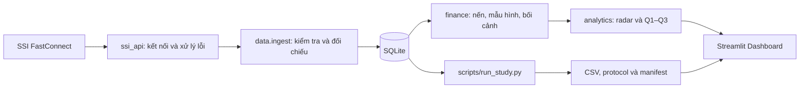

# VN30 Candlestick Radar

**Phát hiện mẫu hình nến · Theo dõi tín hiệu · Kiểm chứng bằng dữ liệu lịch sử**

Ứng dụng Python phân tích giá và khối lượng của nhóm cổ phiếu VN30, sử dụng **SSI FastConnect**, **SQLite** và **Streamlit**. Dự án kết hợp dashboard giải thích tín hiệu với quy trình nghiên cứu Q1–Q3 có thể chạy lại bằng dòng lệnh.

> Công cụ phục vụ học tập và nghiên cứu. Hướng tăng/giảm của mẫu hình không phải lệnh mua/bán hoặc cam kết lợi nhuận.

## Mục lục

1. [Giới thiệu và ý nghĩa dự án](#gioi-thieu)
2. [Kiến trúc hệ thống](#kien-truc)
3. [Yêu cầu môi trường và cài đặt](#cai-dat)
4. [Hướng dẫn vận hành](#van-hanh)
5. [Cấu trúc thư mục dự án](#cau-truc)
6. [Xử lý sự cố thường gặp](#xu-ly-su-co)
7. [Trạng thái, kết quả và hạn chế đã biết](#trang-thai)

<a id="gioi-thieu"></a>
## 1. Giới thiệu và ý nghĩa dự án

Nhà đầu tư mới thường khó phân biệt ý nghĩa của từng mẫu hình nến, điều kiện xác nhận và mức độ đáng tin cậy của tín hiệu. VN30 Candlestick Radar giúp người dùng quan sát thị trường có hệ thống, hiểu điều cần theo dõi và đối chiếu tín hiệu với kết quả lịch sử.

### Chức năng chính

- Thu thập dữ liệu OHLCV ngày và giao dịch tổng hợp từ SSI, lưu vào SQLite.
- Nhận diện mẫu hình nến và cảnh báo sớm khi có hai nến đầu của Sao mai/Sao hôm.
- Giải thích tín hiệu: ý nghĩa, bối cảnh, điều kiện xác nhận và vùng vô hiệu.
- Hiển thị biểu đồ giá, khối lượng và vị trí xuất hiện mẫu hình.
- Lọc tín hiệu, lưu danh sách theo dõi và xuất CSV.
- Kiểm tra chất lượng dữ liệu, lưu nhật ký nạp và truy vết lỗi/cảnh báo.
- Đánh giá lịch sử, bao gồm phần ngoài mẫu theo thời gian.

### Câu hỏi nghiên cứu

| Câu hỏi | Nội dung |
|---|---|
| **Q1 — Tần suất** | Mỗi mẫu hình xuất hiện bao nhiêu lần theo năm và theo mã cổ phiếu? |
| **Q2 — Diễn biến sau tín hiệu** | Sau mẫu hình, giá có đi theo hướng lý thuyết tốt hơn mức nền hay không? |
| **Q3 — Hoàn thành mẫu hình** | Khi đã có cảnh báo hai nến, nến tiếp theo hoàn thành Sao mai/Sao hôm với xác suất bao nhiêu? |

**Mức nền** là kết quả tham chiếu dùng để so sánh với mẫu hình. **Ngoài mẫu** là đoạn thời gian đến sau đoạn dùng để xây dựng các đại lượng tham chiếu. Tỷ lệ hoàn thành mẫu hình ở Q3 không phải tỷ lệ giao dịch có lãi.

<a id="kien-truc"></a>
## 2. Kiến trúc hệ thống



Dashboard đọc SQLite. Nạp SSI được thực hiện bằng lệnh riêng hoặc tác vụ Windows; mở dashboard hay bấm **Đọc lại SQLite** không tự tải giá mới từ SSI.

| Thành phần | Trách nhiệm |
|---|---|
| `ssi_api` | Xác thực, phân trang và xử lý lỗi API. |
| `data` | Ingest, SQLite, kiểm tra chất lượng và đọc snapshot. |
| `finance` | Đặc trưng nến, nhận diện mẫu hình và bối cảnh; không gọi API. |
| `analytics` | Radar, kết quả sau tín hiệu, xác suất hoàn thành và kiểm định. |
| `app` | Giao diện, bộ lọc, giải thích và xuất dữ liệu. |
| `scripts` | Điểm chạy cho cập nhật, nghiên cứu, sao lưu và chụp dashboard. |

SQLite mặc định tại `storage/radar.db`:

| Bảng | Nội dung |
|---|---|
| `ohlc_daily` | Giá mở cửa/cao nhất/thấp nhất/đóng cửa, khối lượng và giá trị giao dịch. |
| `summary_daily` | Dữ liệu giao dịch tổng hợp để đối chiếu. |
| `quality_issues` | Lỗi/cảnh báo theo mã, ngày và loại kiểm tra. |
| `ingest_log` | Thời gian, trạng thái và số dòng của các lần nạp. |

Dữ liệu giá dùng khóa `(symbol, trading_date)`. Ingest kiểm tra trước khi ghi, sử dụng giao dịch SQLite và cơ chế bảo vệ khi thay lịch sử. Script cập nhật có khóa chống chạy đồng thời, sao lưu trước khi nạp và ghi nhật ký.

<a id="cai-dat"></a>
## 3. Yêu cầu môi trường và cài đặt

### 3.1. Môi trường

- **Python 3.10 trở lên**; khuyến nghị Python 3.12.
- Git, trình duyệt và kết nối mạng để cài thư viện.
- Khóa SSI có quyền đọc dữ liệu thị trường nếu cần nạp/cập nhật.
- Windows nếu đăng ký lịch bằng Task Scheduler.

Thư viện chính: NumPy, pandas, requests, python-dotenv, SciPy, Plotly và Streamlit. Giới hạn phiên bản nằm trong [pyproject.toml](pyproject.toml).

### 3.2. Cài đặt trên Windows PowerShell

```powershell
git clone https://github.com/Kieuhttk/vn30-candlestick-radar.git
cd vn30-candlestick-radar
python -m venv .venv
.\.venv\Scripts\python.exe -m pip install --upgrade pip
.\.venv\Scripts\python.exe -m pip install -e ".[dev]"
```

Các lệnh dưới dùng trực tiếp Python trong `.venv`, không bắt buộc kích hoạt môi trường.

Nếu bản bàn giao có `report/environment_lock.txt`, cài file này trước khi cài editable để dùng cùng phiên bản thư viện với bộ kết quả:

```powershell
.\.venv\Scripts\python.exe -m pip install -r report/environment_lock.txt
.\.venv\Scripts\python.exe -m pip install -e ".[dev]"
```

Trên Linux/macOS, tạo môi trường bằng `python3 -m venv .venv` và thay `.\.venv\Scripts\python.exe` bằng `./.venv/bin/python`.

### 3.3. Cấu hình SSI

```powershell
Copy-Item .env.example .env
```

Điền khóa thật vào `.env`:

```dotenv
SSI_API_KEY=your_api_key_here
SSI_API_SECRET=your_api_secret_here
RADAR_DB_PATH=storage/radar.db
```

Dự án chỉ đọc dữ liệu thị trường, không cần OTP/Private Key và không đặt lệnh. Không đưa `.env`, khóa API hoặc thông tin tài khoản lên GitHub. Xem [ghi chú API](docs/api_notes.md).

<a id="van-hanh"></a>
## 4. Hướng dẫn vận hành

Tất cả lệnh chạy từ **thư mục gốc dự án**, nơi có `pyproject.toml`.

### 4.1. Kết nối và nạp dữ liệu lần đầu

```powershell
.\.venv\Scripts\python.exe -m ssi_api.probe FPT
.\.venv\Scripts\python.exe -m data.ingest --db storage/radar.db --since 2021-11-16
```

Lệnh thứ hai nạp các mã trong `src/data/universe_vn30.txt`. Có thể thử ít mã trước:

```powershell
.\.venv\Scripts\python.exe -m data.ingest --db storage/radar.db --symbols FPT,VCB --since 2023-01-01
```

Chọn ngày bắt đầu phù hợp với phạm vi nghiên cứu và giữ thống nhất khi tái lập.

### 4.2. Mở và đọc dashboard

```powershell
$env:RADAR_DB_PATH = "storage/radar.db"
.\.venv\Scripts\python.exe -m streamlit run src/app/main.py
```

Mở **http://localhost:8501**.

| Trang | Cách sử dụng |
|---|---|
| **Radar** | Xem tín hiệu theo ngày; chọn tín hiệu để đọc ý nghĩa, trạng thái và điều kiện theo dõi. |
| **Biểu đồ** | Xem giá, khối lượng và vị trí các mẫu hình của từng mã. |
| **Kết quả nghiên cứu** | Xem thống kê hoàn thành mẫu hình và diễn biến sau tín hiệu; mở mục ngoài mẫu để đọc bộ đã chạy bằng `--oos`. |
| **Chất lượng** | Đối chiếu ngày dữ liệu, lỗi/cảnh báo và trạng thái nạp. |
| **Phương pháp** | Đọc quy tắc nhận diện, cách tính và cách diễn giải. |

Với người mới: đọc **ý nghĩa → đang chờ hay đã đủ nến → bối cảnh → điều kiện theo dõi → thống kê lịch sử**. Đủ mẫu hình không đồng nghĩa phiên tiếp theo chắc chắn tăng/giảm.

### 4.3. Cập nhật dữ liệu và cài lịch

Sau khi đã có DB:

```powershell
.\.venv\Scripts\python.exe scripts/data/update_data.py --db storage/radar.db
.\.venv\Scripts\python.exe scripts/data/update_data.py --db storage/radar.db --status
```

Backup ở `storage/backups/`; log ở `report/update_logs/`. Đối chiếu ngày cuối **của từng mã** thay vì chỉ dựa vào thông báo lệnh thành công.

Nến ngày hiện tại chỉ được phân tích sau 15:00 giờ Việt Nam. Đây là mốc lọc của ứng dụng; SSI có thể công bố dữ liệu muộn hơn. Mốc ngày thường trong script chưa thay thế lịch nghỉ giao dịch chính thức.

Cài lịch trên Windows:

```powershell
.\.venv\Scripts\python.exe scripts/system/install_update_task.py --at 18:00 --retry-at 19:00 --db storage/radar.db
.\.venv\Scripts\python.exe scripts/system/install_update_task.py --status
```

Lịch dùng giờ hệ thống Windows; đặt đúng múi giờ Việt Nam. Máy phải bật, không ngủ, có mạng và người dùng đã đăng nhập. Di chuyển thư mục dự án thì cần đăng ký lại lịch.

### 4.4. Kiểm tra chất lượng

```powershell
.\.venv\Scripts\python.exe -m data.ingest --db storage/radar.db --status
.\.venv\Scripts\python.exe -m data.ingest --db storage/radar.db --audit
.\.venv\Scripts\python.exe -m data.ingest --db storage/radar.db --log
.\.venv\Scripts\python.exe -m data.ingest --db storage/radar.db --issues --symbols FPT
.\.venv\Scripts\python.exe scripts/data/check_data.py
```

`check_data.py` hiện đọc cố định `storage/radar.db`, xuất `report/data_quality.csv`. Với DB khác, dùng `data.ingest --db ... --audit`.

`SQLite quick_check: OK` xác nhận tính toàn vẹn DB, chưa chứng minh mọi giá/khối lượng đúng. Cảnh báo thiếu phiên hoặc vượt biên độ cần đối chiếu lịch nghỉ, lịch sử niêm yết/chuyển sàn và nguồn dữ liệu.

### 4.5. Chạy nghiên cứu Q1–Q3

Ví dụ dùng **DB đã đóng băng** cho hồ sơ chốt 24/11/2026, phiên giá cuối 23/11/2026:

```powershell
.\.venv\Scripts\python.exe scripts/run_study.py --db storage/radar_final_20261124.db --asof 2026-11-23 --sensitivity --out report/tables_final
.\.venv\Scripts\python.exe scripts/run_study.py --db storage/radar_final_20261124.db --asof 2026-11-23 --oos --train-end 2025-05-20 --sensitivity --resamples 39999 --out report/oos_verified
```

Phải tạo và kiểm tra DB chốt trước hai lệnh này. Quy trình sao lưu, chốt dữ liệu và chạy các phần bổ sung ở [RESEARCH_GUIDE.md](docs/RESEARCH_GUIDE.md).

Kết quả gồm CSV, `manifest.json` và protocol ngoài mẫu. **Manifest** ghi nguồn và mã băm để kiểm tra tính toàn vẹn; **protocol** lưu thiết kế và mốc chia thời gian. Không sửa chúng để bỏ qua lỗi không khớp. Khi nguồn hoặc module số học thay đổi, tạo bộ nghiên cứu phiên bản mới.

Q2 dùng kỳ hạn **1, 3, 5, 10, 20 phiên**, chi phí giả định **20/40 bps** (0,20%/0,40%). Đọc kết quả cùng số quan sát, khoảng tin cậy và q sau hiệu chỉnh nhiều kiểm định, không chỉ p thô.

### 4.6. Kiểm thử

```powershell
.\.venv\Scripts\python.exe -m pytest -q
git rev-parse HEAD
```

Kiểm chứng bản bàn giao bằng clone mới của commit đã push; lưu kết quả pytest cùng SHA commit. Không lấy số kiểm thử của phiên bản khác để ghi vào báo cáo.

### 4.7. Demo offline và chụp giao diện

Nếu bản clone **có sẵn** `data_sample/radar_demo.db`, chạy không cần khóa SSI:

```powershell
$env:RADAR_DB_PATH = "data_sample/radar_demo.db"
.\.venv\Scripts\python.exe -m streamlit run src/app/main.py
```

Nếu chưa có file DB này thì chưa có demo offline hoàn chỉnh. Xem [cách đóng gói dữ liệu mẫu](data_sample/README.md). Tab nghiên cứu còn cần bộ kết quả khớp với DB và code.

Với công cụ chụp đã vá, giữ dashboard đang chạy và mở terminal thứ hai:

```powershell
.\.venv\Scripts\python.exe -m pip install -e ".[screenshots]"
.\.venv\Scripts\python.exe -m playwright install chromium
.\.venv\Scripts\python.exe scripts/app/capture_dashboard.py --url http://localhost:8501 --expect-asof 2026-11-23 --cutoff-date 2026-11-24 --out report/screenshots_final_20261124
```

Hai cờ ngày thuộc bản vá công cụ chụp. Dùng thư mục đầu ra mới/trống; thời gian chụp thực được ghi trong `capture_manifest.json`.

<a id="cau-truc"></a>
## 5. Cấu trúc thư mục dự án

```text
vn30-candlestick-radar/
├── .streamlit/                  # Cấu hình giao diện
├── assets/fonts/                # Font và giấy phép
├── src/
│   ├── ssi_api/                 # Client SSI, cấu hình, probe
│   ├── data/                    # SQLite, ingest, chất lượng, snapshot
│   │   └── universe_vn30.txt    # Danh sách mã của dự án
│   ├── finance/                 # Nến, mẫu hình, chỉ báo, bối cảnh
│   ├── analytics/               # Radar, event study, Q3, suy luận
│   └── app/                     # Dashboard Streamlit
├── scripts/
│   ├── data/                    # Cập nhật/kiểm tra dữ liệu
│   ├── system/                  # Lịch Windows
│   ├── app/                     # Chụp dashboard
│   ├── analytics/               # Lệnh thống kê cảnh báo
│   ├── research/                # Hiệu chuẩn và kiểm tra độ vững
│   ├── maintenance/             # Bảo trì cấu trúc
│   ├── backup_sqlite.py         # Sao lưu SQLite
│   └── run_study.py             # Chạy Q1–Q3
├── tests/                       # Kiểm thử tự động
├── docs/                        # Định nghĩa, API, hướng dẫn
├── data_sample/                 # Tài liệu/DB demo khi đã đóng gói
├── storage/                     # DB và backup, sinh cục bộ
├── report/                      # Bảng, manifest, ảnh và log
├── archive/                     # Trình cài cũ
├── .env.example
├── .gitignore
├── pyproject.toml
└── README.md
```

`storage/`, `.venv/` và log vận hành được tạo khi sử dụng, không bắt buộc có trong clone. Không chạy các trình nâng cấp trong `archive/installers/` để khởi động dashboard.

<a id="xu-ly-su-co"></a>
## 6. Xử lý sự cố thường gặp

| Hiện tượng | Cách xử lý |
|---|---|
| `No module named data` hoặc `analytics` | Dùng Python trong `.venv`, chạy tại gốc dự án và cài lại bằng `python -m pip install -e ".[dev]"`. |
| `can't open file capture_dashboard.py` | File nằm ở `scripts/app/capture_dashboard.py`; dùng đúng đường dẫn. |
| Dashboard không có dữ liệu | Kiểm tra DB tồn tại, `RADAR_DB_PATH` và đường dẫn trong sidebar; nạp lần đầu hoặc dùng DB demo. |
| Giá vẫn ở ngày cũ | Chạy script cập nhật; kiểm tra ngày cuối từng mã, lịch nghỉ, log SSI và đường dẫn tác vụ. Nếu đang xem ngày lịch sử, chọn “Về phiên gần nhất”. |
| Lịch báo thành công nhưng chưa có phiên mới | Exit code 0 chỉ xác nhận tiến trình; đối chiếu dữ liệu thực tế vì có thể ngày nghỉ, SSI trả chậm hoặc một số mã thiếu. |
| Không hiển thị ngoài mẫu | Kiểm tra `report/oos_verified/`, ngày quét, manifest, protocol và sự khớp dữ liệu/code. Không bỏ kiểm tra hash để ép hiển thị. |
| `database is locked` hoặc đang cập nhật | Chờ tác vụ hiện tại kết thúc; tránh nhiều lệnh ingest cùng DB. Không xóa file khóa/WAL khi tiến trình còn chạy. |
| SSI thiếu khóa hoặc từ chối xác thực | Kiểm tra `.env`, quyền đọc dữ liệu và hiệu lực khóa; thử `python -m ssi_api.probe FPT`. |
| Thiếu `data.radar_store` hoặc fixture UI | Kiểm tra đầy đủ `src/`, `tests/`, `conftest.py` của cùng phiên bản; cài lại editable. |
| Ba test UI còn kỳ vọng năm biểu đồ | Áp dụng bản vá `tests/refresh_radar/test_ui.py` cho giao diện bốn biểu đồ, chạy toàn bộ test và xác nhận commit đã push. |
| Giao diện vẫn như cũ | Kiểm tra server chạy đúng thư mục/venv; Ctrl+C rồi khởi động lại. Không chạy trình nâng cấp cũ. |

<a id="trang-thai"></a>
## 7. Trạng thái, kết quả và hạn chế đã biết

### 7.1. Trạng thái triển khai

| Hạng mục | Trạng thái |
|---|---|
| Nạp SSI, SQLite và kiểm tra chất lượng | Đã triển khai. |
| Bảo vệ refresh, backup và log | Đã triển khai; vẫn phải đối chiếu ngày cuối từng mã. |
| Dashboard năm trang, giải thích và lọc tín hiệu | Đã triển khai. |
| Q1–Q3, ngoài mẫu và phân tích độ nhạy | Đã có mã chạy và các bộ kết quả đã xuất. |
| Hiệu chuẩn, Q3 so nền, sức mạnh kiểm định, loại mã và lịch nghỉ | Đã có script; phải dùng đúng output được trích dẫn. |
| Bộ cuối chốt 24/11/2026 | Cần chạy và kiểm chứng cùng DB, CSV, ảnh và báo cáo theo hướng dẫn chốt. |
| Q4 — học máy | Chưa triển khai; ngoài phạm vi bản hiện tại. |

### 7.2. Kết quả và bằng chứng tái lập

- Bộ chính được đối chiếu trước lần chốt mới có `asof = 2026-11-20`, mốc train **20/05/2025**. Không đổi nhãn bộ này thành dữ liệu 24/11.
- Một số kết quả bổ sung cũ dùng dữ liệu 16/11. Khi cập nhật, chạy lại từ cùng snapshot; không ghép các mẫu số khác phiên bản.
- Bản checkout có áp dụng bản vá UI đã kiểm tra ngày **25/11/2026**, đạt **229 kiểm thử**. Con số này chưa xác nhận GitHub đã chứa bản vá; bằng chứng cuối phải là log từ clone sạch của commit đã push.
- Chưa xác nhận CSV và ảnh cuối chốt 24/11 trong lần biên soạn README này. Lấy số liệu kết luận từ CSV đã kiểm chứng, không chép số cũ hoặc suy ra từ ảnh dashboard.

Hồ sơ chốt 24/11/2026 dùng phiên giá cuối **23/11/2026**, vì ngày 24 nghỉ giao dịch theo [HNX](https://knowledge.hnx.vn/vi-vn/chi-tiet-lich-nghi-gd-60023839.html?_page=1) và [VSDC](https://vsdc.vn/vi/ad/202680). Phân biệt ngày chốt, ngày thu thập và ngày chạy/chụp thực tế.

| Đầu ra | Vai trò |
|---|---|
| `report/tables_final/` | Thống kê toàn mẫu và độ nhạy của bộ chốt. |
| `report/oos_verified/q2_oos_summary.csv` | Q2 ngoài mẫu theo mẫu hình, kỳ hạn và phí. |
| `report/oos_verified/q3_oos_summary.csv` | Q3 ngoài mẫu. |
| `report/oos_verified/manifest.json`, `oos_protocol.json` | Nguồn, thiết kế, mốc thời gian và mã băm. |
| `report/supplement_20261124/` | Kiểm tra bổ sung sau khi chạy lại cùng bộ chính. |
| `report/screenshots_final_20261124/` | Ảnh và manifest sau bước chốt. |

Tên thư mục là vị trí đích; cần kiểm tra file thực sự tồn tại và manifest hoàn tất. Không bác bỏ giả thuyết gốc không đồng nghĩa đã chứng minh mẫu hình không có tác dụng.

### 7.3. Hạn chế còn lại

- **Rổ cố định:** chưa tái dựng thành phần VN30 tại từng thời điểm, có nguy cơ sai lệch do lựa chọn rổ hiện tại.
- **Ngoài mẫu hồi cứu:** tách theo thời gian nhưng lịch sử từng được khám phá; chưa phải kiểm chứng trên dữ liệu tương lai chưa quan sát.
- **Giá có thể điều chỉnh:** lần nạp SSI mới có thể thay đổi quá khứ. Cần lưu snapshot và ngày thu thập; lọc ngày không khôi phục được phiên bản dữ liệu cũ.
- **Lịch và chất lượng:** có đối chiếu lịch công bố nhưng chưa bao quát mọi đợt ngừng riêng lẻ hoặc thay đổi sàn.
- **Sức mạnh thống kê:** một số mẫu hình hiếm; các mã/ngày và nhãn có liên hệ. Cần đọc khoảng tin cậy và q cùng độ lớn hiệu ứng.
- **Khả năng giao dịch:** phí/trượt giá là giả định hoặc kịch bản. Dữ liệu ngày chưa mô phỏng đầy đủ thanh khoản, hàng chờ và thanh toán; kỳ hạn một phiên chủ yếu đo diễn biến giá.
- **Quy tắc trên UI:** vượt đỉnh/đáy, vùng vô hiệu và ngưỡng khối lượng hỗ trợ diễn giải, chưa phải chiến lược sinh lời đã được xác nhận.
- **Vận hành cục bộ:** cập nhật tự động phụ thuộc máy Windows, mạng, lịch tác vụ và nguồn SSI.

### 7.4. Tài liệu liên quan

- [Chốt và tái lập nghiên cứu](docs/RESEARCH_GUIDE.md).
- [Định nghĩa mẫu hình](docs/pattern_definitions.md).
- [Ghi chú kiểm chứng SSI](docs/api_notes.md).
- [Quyết định xử lý chất lượng dữ liệu](docs/data_quality_decisions.md).
- [Sửa lịch cập nhật](docs/AUTO_UPDATE_REPAIR.md).
- [Hướng dẫn tính năng dashboard](docs/UPGRADE_FEATURES.md).
