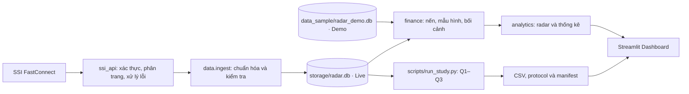

# VN30 Candlestick Radar

**Phát hiện mẫu hình nến · Theo dõi tín hiệu · Kiểm chứng bằng dữ liệu lịch sử**

Công cụ Python phân tích giá và khối lượng của nhóm cổ phiếu VN30, sử dụng **SSI FastConnect**, **SQLite**, **Streamlit** và **Plotly**.

Dashboard có **hai chế độ xem**, chuyển trực tiếp ở sidebar:

- **Demo báo cáo:** xem dữ liệu cố định trong `data_sample/radar_demo.db`, chạy offline và không cần khóa SSI.
- **Hằng ngày (Live):** theo dõi phiên đã đóng mới nhất được lưu trong `storage/radar.db`, cập nhật qua SSI bằng script hoặc lịch Windows.

**Mốc dữ liệu của hồ sơ nghiên cứu: 27/11/2026.** Mốc kết thúc train giữ tại **20/05/2025**. Dashboard làm việc tiếp tục cập nhật các phiên mới; bộ nghiên cứu và demo của bản nộp được cố định theo mốc chốt.

> Dự án phục vụ học tập và nghiên cứu. Hướng tăng/giảm của mẫu hình không phải lệnh mua/bán hoặc cam kết lợi nhuận.

## Mục lục

1. [Giới thiệu và ý nghĩa dự án](#gioi-thieu)
2. [Kiến trúc hệ thống](#kien-truc)
3. [Yêu cầu môi trường và cài đặt](#cai-dat)
4. [Hướng dẫn vận hành](#van-hanh)
5. [Cấu trúc thư mục dự án](#cau-truc)
6. [Xử lý sự cố thường gặp](#xu-ly-su-co)
7. [Trạng thái, kết quả và hạn chế đã biết](#trang-thai)

<a id="gioi-thieu"></a>
## 1. Giới thiệu và ý nghĩa dự án

Nhà đầu tư mới thường khó phân biệt ý nghĩa của mẫu hình nến, điều kiện xác nhận và độ tin cậy của tín hiệu. VN30 Candlestick Radar giúp người dùng quan sát thị trường có hệ thống, hiểu điều cần theo dõi và đối chiếu tín hiệu với kết quả lịch sử.

### 1.1. Chức năng chính

- Nạp dữ liệu OHLCV ngày và giao dịch tổng hợp từ SSI, lưu vào SQLite.
- Nhận diện mẫu hình nến; cảnh báo sớm khi có hai nến đầu của Sao mai/Sao hôm.
- Giải thích tín hiệu theo từng bước: ý nghĩa, bối cảnh, trạng thái, điều kiện theo dõi và vùng vô hiệu.
- Hiển thị biểu đồ giá, khối lượng và vị trí xuất hiện mẫu hình.
- Lọc tín hiệu, lưu danh sách quan tâm và xuất CSV.
- Kiểm tra chất lượng dữ liệu, lưu nhật ký và truy vết lỗi/cảnh báo.
- Kiểm chứng thống kê trên lịch sử, có đánh giá ngoài mẫu theo thời gian và các kiểm tra độ vững.
- Chuyển Demo ↔ Live ngay trên giao diện; ngày quét theo nguồn dữ liệu vừa chọn.

### 1.2. Câu hỏi nghiên cứu

| Câu hỏi | Nội dung |
|---|---|
| **Q1 — Tần suất** | Mỗi mẫu hình xuất hiện bao nhiêu lần theo năm và theo mã cổ phiếu? |
| **Q2 — Diễn biến sau tín hiệu** | Sau mẫu hình, giá có đi theo hướng lý thuyết tốt hơn mức nền hay không? |
| **Q3 — Hoàn thành mẫu hình** | Khi đã có cảnh báo hai nến, nến tiếp theo hoàn thành Sao mai/Sao hôm với xác suất bao nhiêu? |

**Mức nền** là kết quả tham chiếu để so sánh với mẫu hình. **Ngoài mẫu** là đoạn thời gian đến sau đoạn dùng để ước lượng các đại lượng tham chiếu. Tỷ lệ hoàn thành mẫu hình ở Q3 không phải tỷ lệ giao dịch có lãi.

<a id="kien-truc"></a>
## 2. Kiến trúc hệ thống



Dashboard đọc một trong hai DB theo chế độ đang chọn. Lấy dữ liệu mới từ SSI được thực hiện bằng lệnh ingest hoặc tác vụ Windows. Nút **Đọc lại SQLite** đọc lại nguồn đang chọn; chuyển chế độ không gọi API hoặc ghi vào DB.

| Thành phần | Trách nhiệm |
|---|---|
| `src/ssi_api/` | Xác thực, phân trang, giới hạn tần suất và xử lý lỗi API. |
| `src/data/` | Nạp dữ liệu, SQLite, kiểm tra chất lượng và đọc snapshot. |
| `src/finance/` | Đặc trưng nến, nhận diện mẫu hình, chỉ báo và bối cảnh; không gọi API. |
| `src/analytics/` | Radar, lợi suất sau tín hiệu, xác suất hoàn thành và kiểm định. |
| `src/app/` | Giao diện, bộ lọc, giải thích và xuất dữ liệu. |
| `scripts/` | Điểm chạy cập nhật, nghiên cứu, sao lưu và chụp dashboard. |

SQLite gồm bốn bảng chính:

| Bảng | Nội dung |
|---|---|
| `ohlc_daily` | Giá mở cửa/cao nhất/thấp nhất/đóng cửa, khối lượng và giá trị giao dịch. |
| `summary_daily` | Dữ liệu giao dịch tổng hợp để đối chiếu. |
| `quality_issues` | Lỗi/cảnh báo theo mã, ngày và loại kiểm tra. |
| `ingest_log` | Thời gian, phạm vi, trạng thái và số dòng của lần nạp. |

Dữ liệu giá dùng khóa `(symbol, trading_date)`. Ingest kiểm tra trước khi ghi, sử dụng giao dịch SQLite và chốt an toàn khi thay lịch sử. Script cập nhật có backup, khóa chống chạy đồng thời và nhật ký vận hành.

<a id="cai-dat"></a>
## 3. Yêu cầu môi trường và cài đặt

### 3.1. Môi trường

- **Khuyến nghị Python 3.12** để tái lập môi trường chốt.
- Git, trình duyệt và kết nối mạng để cài thư viện.
- Khóa SSI có quyền đọc dữ liệu thị trường khi cần nạp/cập nhật.
- Windows nếu đăng ký lịch bằng Task Scheduler.

Thư viện chính gồm NumPy, pandas, requests, python-dotenv, SciPy, Plotly và Streamlit. [pyproject.toml](pyproject.toml) khai báo Python tối thiểu 3.10 và phạm vi thư viện; bộ lock phục vụ tái lập được kiểm tra với Python 3.12.

### 3.2. Cài đặt trên Windows PowerShell

```powershell
git clone https://github.com/Kieuhttk/vn30-candlestick-radar.git
cd vn30-candlestick-radar
python -m venv .venv
.\.venv\Scripts\python.exe -m pip install -r report/environment_lock.txt
.\.venv\Scripts\python.exe -m pip install -e ".[dev,screenshots]"
```

Chạy các lệnh từ thư mục gốc dự án, nơi có `pyproject.toml`. Dùng trực tiếp Python trong `.venv` giúp tránh nhầm interpreter, không bắt buộc kích hoạt môi trường.

Trên Linux/macOS, tạo venv bằng `python3 -m venv .venv` và thay `.\.venv\Scripts\python.exe` bằng `./.venv/bin/python`.

Để tái lập kết quả đã chốt, dùng file lock đi kèm đúng bộ kết quả. Không tự nâng NumPy/pandas trong lúc tái lập.

### 3.3. Cấu hình SSI khi cần lấy dữ liệu

Demo SQLite không cần khóa API. Khi muốn nạp/cập nhật:

```powershell
Copy-Item .env.example .env
```

Điền khóa thật trong `.env`:

```dotenv
SSI_API_KEY=your_api_key_here
SSI_API_SECRET=your_api_secret_here
RADAR_DB_PATH=storage/radar.db
```

Dự án chỉ đọc dữ liệu thị trường, không đặt lệnh, không cần OTP/Private Key. Không commit `.env`, khóa API hoặc thông tin tài khoản. Xem [ghi chú kiểm chứng API](docs/api_notes.md).

<a id="van-hanh"></a>
## 4. Hướng dẫn vận hành

### 4.1. Hai chế độ xem: Demo và Live

| Chế độ trong sidebar | File được đọc | Dùng khi nào? |
|---|---|---|
| **Demo báo cáo** | `data_sample/radar_demo.db` | Xem bản dữ liệu đã chốt, demo offline và đối chiếu báo cáo. |
| **Hằng ngày (Live)** | `storage/radar.db` | Theo dõi dữ liệu làm việc, tiếp tục nạp các phiên mới từ SSI. |

Trong phần **Chế độ dữ liệu**, chọn Demo hoặc Live để chuyển nguồn ngay, không cần sửa `.env` hay khởi động lại server. Mục **Nguồn dữ liệu** cho xem đường dẫn cố định của chế độ đã chọn; ô này chỉ đọc.

- Mỗi lần đổi nguồn, **Ngày quét** về phiên đã đóng mới nhất có trong DB vừa chọn; trang và bộ lọc mã được giữ lại.
- Nếu đang theo dõi phiên mới nhất ở Live, ngày quét tự theo phiên mới khi DB được cập nhật. Nếu đang xem ngày lịch sử, ngày đó được giữ lại; dùng **Về phiên gần nhất** để quay về hiện tại.
- Khi đang mở, dashboard kiểm tra thay đổi SQLite mỗi **60 giây**. Có thể bấm **Đọc lại SQLite** để đọc ngay.
- Nếu nguồn chưa có file, giao diện báo rõ và vẫn cho chuyển sang nguồn còn lại; không tự tạo DB rỗng.

**Live là dữ liệu ngày đã đóng được lưu trong DB**, không phải bảng giá trong phiên. Độ mới phụ thuộc lần nạp SSI; chuyển sang Live không tự chạy ingest. Nến hôm nay chỉ được phân tích sau 15:00 giờ Việt Nam và khi nguồn đã trả dữ liệu.

Khi mở ứng dụng lần đầu, `RADAR_DB_PATH` có thể chọn mặc định nếu trỏ đúng một trong hai file trên. Nếu không, ứng dụng ưu tiên Live khi DB làm việc tồn tại, rồi đến Demo. Đường dẫn khác không bổ sung chế độ thứ ba.

Snapshot nghiên cứu `storage/radar_final_20261127.db` được tạo cục bộ theo quy trình chốt và dùng bởi các script nghiên cứu. Không đưa snapshot vào lịch cập nhật SSI. DB làm việc có thể tiếp tục cập nhật sau 27/11; bộ báo cáo và demo của bản nộp giữ dữ liệu đến **27/11/2026**. Một phiên bản nghiên cứu mới cần snapshot và bộ kết quả riêng.

### 4.2. Chạy demo offline

Kiểm tra DB demo đi kèm thuộc đúng mốc 27/11:

```powershell
.\.venv\Scripts\python.exe -c "import json; from pathlib import Path; m=json.loads(Path('data_sample/metadata.json').read_text(encoding='utf-8')); assert m['last_market_session']=='2026-11-27', 'Demo is not the 2026-11-27 version'; print('Demo cutoff:', m['last_market_session'])"
if ($LASTEXITCODE -ne 0) { throw "Demo chưa đúng phiên bản. Kiểm tra dữ liệu đi kèm." }

$env:RADAR_DB_PATH = "data_sample/radar_demo.db"
.\.venv\Scripts\python.exe -m streamlit run src/app/main.py
```

Mở **http://localhost:8501** và chọn **Demo báo cáo** ở sidebar nếu chưa được chọn. Kiểm tra mục **Nguồn dữ liệu** trỏ tới `data_sample/radar_demo.db` và ngày phân tích 27/11/2026. Có thể chuyển sang Live ngay trên giao diện nếu đã có DB làm việc. Tab ngoài mẫu còn kiểm tra fingerprint với bộ CSV, không chỉ dựa vào metadata.

DB demo có thể đã loại `ingest_log` khi đóng gói. Tab **Chất lượng** giải thích việc thiếu nhật ký vận hành; thông tin nguồn và thời gian đóng gói nằm trong `data_sample/metadata.json`. Tình trạng này cần phân biệt với thiếu dữ liệu giá.

Nếu metadata/DB vẫn thuộc mốc cũ, hoàn tất [quy trình chốt](docs/RESEARCH_GUIDE.md) trước khi giới thiệu đó là demo 27/11. Thông tin đóng gói nằm tại [data_sample/README.md](data_sample/README.md).

### 4.3. Cách đọc dashboard

| Trang | Cách sử dụng |
|---|---|
| **Radar** | Chọn tín hiệu để đọc ý nghĩa, trạng thái, bối cảnh và điều kiện theo dõi. |
| **Biểu đồ** | Xem giá, khối lượng và vị trí xuất hiện mẫu hình của từng mã. |
| **Kết quả nghiên cứu** | Phân biệt thống kê toàn mẫu, kết quả ngoài mẫu và xác suất hoàn thành mẫu hình. |
| **Chất lượng** | Kiểm tra ngày dữ liệu từng mã, lỗi/cảnh báo và trạng thái nạp. |
| **Phương pháp** | Đọc quy tắc nhận diện, giả định và cách diễn giải kết quả. |

Với người mới, đọc theo thứ tự **ý nghĩa → trạng thái → bối cảnh → điều kiện theo dõi → thống kê lịch sử**. Đủ mẫu hình không đồng nghĩa phiên sau chắc chắn tăng/giảm.

### 4.4. Nạp lần đầu và cập nhật hằng ngày

Kiểm tra kết nối và nạp cả danh sách mã:

```powershell
.\.venv\Scripts\python.exe -m ssi_api.probe FPT
.\.venv\Scripts\python.exe -m data.ingest --db storage/radar.db --since 2021-11-16
```

Danh sách nằm trong `src/data/universe_vn30.txt`. Có thể thử ít mã bằng `--symbols FPT,VCB`.

Sau khi đã có DB, cập nhật bằng script có backup:

```powershell
.\.venv\Scripts\python.exe scripts/data/update_data.py --db storage/radar.db
.\.venv\Scripts\python.exe scripts/data/update_data.py --db storage/radar.db --status
```

Backup nằm trong `storage/backups/`; log ở `report/update_logs/`. Đối chiếu ngày cuối từng mã. Exit code 0 chưa tự bảo đảm SSI đã trả phiên mới nhất.

Nếu dashboard đang mở, chọn **Hằng ngày (Live)** ở sidebar. Nếu chưa mở, chạy:

```powershell
.\.venv\Scripts\python.exe -m streamlit run src/app/main.py
```

Chọn **Hằng ngày (Live)** và đối chiếu ngày dữ liệu của từng mã. Không cần khởi động lại dashboard sau khi ingest; chờ lần kiểm tra SQLite hoặc bấm **Đọc lại SQLite**. Chọn **Về phiên gần nhất** nếu đang xem ngày lịch sử. SSI có thể công bố dữ liệu muộn hơn giờ đóng cửa; mốc ngày thường của script chưa thay thế lịch nghỉ chính thức.

Cài và kiểm tra lịch Windows:

```powershell
.\.venv\Scripts\python.exe scripts/system/install_update_task.py --at 18:00 --retry-at 19:00 --db storage/radar.db
.\.venv\Scripts\python.exe scripts/system/install_update_task.py --status
```

Lịch dùng giờ Windows; đặt đúng múi giờ Việt Nam. Máy phải bật, không ngủ, có mạng và người dùng đăng nhập. Nếu chuyển vị trí dự án, đăng ký lại lịch. Lịch chỉ cập nhật `storage/radar.db`; giữ nguyên DB demo và snapshot nghiên cứu.

### 4.5. Kiểm tra chất lượng dữ liệu

```powershell
.\.venv\Scripts\python.exe -m data.ingest --db storage/radar.db --status
.\.venv\Scripts\python.exe -m data.ingest --db storage/radar.db --audit
.\.venv\Scripts\python.exe -m data.ingest --db storage/radar.db --log
.\.venv\Scripts\python.exe -m data.ingest --db storage/radar.db --issues --symbols FPT
.\.venv\Scripts\python.exe scripts/data/check_data.py
```

`check_data.py` đọc cố định `storage/radar.db` và xuất `report/data_quality.csv`. Với DB khác, dùng `data.ingest --db ... --audit`.

`SQLite quick_check: OK` xác nhận tính toàn vẹn DB, chưa chứng minh mọi giá đúng. Cảnh báo thiếu phiên/vượt biên độ cần đối chiếu lịch nghỉ, niêm yết/chuyển sàn và nguồn. Cảnh báo dữ liệu khác với warning của pytest.

### 4.6. Chạy và tái lập nghiên cứu

Bộ hoạt động cho dashboard ở `report/tables_final/` và `report/oos_verified/`. Quy trình tạo snapshot mới, giữ bộ cũ và chạy tám phần nghiên cứu/bổ sung nằm trong [RESEARCH_GUIDE.md](docs/RESEARCH_GUIDE.md).

Với **snapshot 27/11 đã tạo và kiểm tra**, các lệnh chính là:

```powershell
.\.venv\Scripts\python.exe scripts/run_study.py --db storage/radar_final_20261127.db --asof 2026-11-27 --sensitivity --out report/tables_final
.\.venv\Scripts\python.exe scripts/run_study.py --db storage/radar_final_20261127.db --asof 2026-11-27 --oos --train-end 2025-05-20 --sensitivity --resamples 39999 --out report/oos_verified
```

Chỉ chạy vào các đường dẫn hoạt động sau bước sao lưu bộ cũ trong hướng dẫn. Không chạy lại chỉ vì cần mở dashboard.

Người chấm không có DB trong `storage/` có thể tái tính từ **demo đã xác nhận mốc 27/11**, dùng thư mục đầu ra mới:

```powershell
.\.venv\Scripts\python.exe scripts/run_study.py --db data_sample/radar_demo.db --asof 2026-11-27 --sensitivity --out report/reproduction_20261127/in_sample
.\.venv\Scripts\python.exe scripts/run_study.py --db data_sample/radar_demo.db --asof 2026-11-27 --oos --train-end 2025-05-20 --sensitivity --resamples 39999 --out report/reproduction_20261127/oos
```

Tái tính ngoài mẫu có thể lâu. Giữ đúng rổ, mốc train, ngưỡng, phiên bản thư viện, phí, kỳ hạn và lượt lấy mẫu. Bộ tái tính có manifest riêng; không thay manifest của bộ đã bàn giao.

Q2 dùng kỳ hạn **1/3/5/10/20 phiên**, phí giả định **20/40 bps** (0,20%/0,40%) và họ chính **280 giả thuyết**. Số kiểm định có kết quả hợp lệ phụ thuộc dữ liệu. Đọc hiệu ứng cùng CI, p và q sau hiệu chỉnh; không chỉ chọn p nhỏ.

**Manifest** lưu nguồn và mã băm; **protocol** lưu thiết kế nghiên cứu. Nếu báo không khớp, đối chiếu đúng phiên bản thay vì sửa hash để bỏ qua kiểm tra.

### 4.7. Kiểm thử và chụp dashboard

```powershell
.\.venv\Scripts\python.exe -m pytest -q
git rev-parse HEAD
```

Bản cập nhật hai chế độ có **239 kiểm thử**, gồm **14 test giao diện**. Kết quả xác nhận cho bản bàn giao phải lấy từ lần chạy thật trên commit đã push và kiểm chứng lại từ clone sạch. Log/metadata hiện hành nằm trong `report/verification/`; bằng chứng cũ cần ghi rõ là lịch sử. Không dùng số test của bản vá để thay bằng chứng kiểm thử của commit khác.

Để chụp ảnh, mở dashboard bằng DB demo 27/11, giữ server chạy và dùng terminal thứ hai:

```powershell
.\.venv\Scripts\python.exe -m playwright install chromium
.\.venv\Scripts\python.exe scripts/app/capture_dashboard.py --url http://localhost:8501 --expect-asof 2026-11-27 --cutoff-date 2026-11-27 --out report/screenshots_final_20261127
```

Thư mục ảnh phải mới/trống. `capture_manifest.json` giữ thời gian chụp thực; không đổi ngược ngày chụp thành ngày chốt. Video demo và báo cáo cuối dùng cùng bộ dữ liệu và hình minh họa.

<a id="cau-truc"></a>
## 5. Cấu trúc thư mục dự án

```text
vn30-candlestick-radar/
├── .streamlit/                  # Cấu hình giao diện
├── assets/fonts/                # Font và giấy phép
├── src/
│   ├── ssi_api/                 # Kết nối SSI và probe
│   ├── data/                    # SQLite, ingest, chất lượng, snapshot
│   │   └── universe_vn30.txt    # Rổ mã cố định
│   ├── finance/                 # Nến, mẫu hình, chỉ báo, bối cảnh
│   ├── analytics/               # Radar, Q1–Q3 và suy luận
│   └── app/                     # Dashboard Streamlit
├── scripts/
│   ├── data/                    # Cập nhật/kiểm tra dữ liệu
│   ├── system/                  # Lịch Windows
│   ├── app/                     # Chụp dashboard
│   ├── analytics/               # Lệnh thống kê cảnh báo
│   ├── research/                # Mô phỏng và kiểm tra độ vững
│   ├── maintenance/             # Bảo trì cấu trúc
│   ├── backup_sqlite.py         # Sao lưu SQLite
│   └── run_study.py             # Chạy Q1–Q3
├── tests/                       # Kiểm thử tự động
├── docs/                        # API, định nghĩa, hướng dẫn
├── data_sample/                 # DB demo và metadata
├── storage/                     # DB làm việc/snapshot/backup cục bộ
├── report/
│   ├── tables_final/            # Kết quả toàn mẫu
│   ├── oos_verified/            # Kết quả ngoài mẫu và protocol
│   ├── supplement_20261127/     # Power, Q3 so nền, loại mã, lịch
│   ├── presentation/           # Bảng trình bày và số liệu báo cáo
│   ├── screenshots_final_20261127/
│   ├── calibration_oos/        # Bằng chứng mô phỏng được sử dụng
│   └── verification/           # Log/XML/manifest kiểm thử
├── archive/installers/          # Trình cài cũ còn dùng trong test
├── .env.example
├── .gitignore
├── pyproject.toml
└── README.md
```

`storage/`, `.venv/` và log vận hành được sinh cục bộ. Các tên đầu ra mô tả bộ 27/11; phải kiểm tra manifest hoàn tất và dữ liệu khớp trước khi công bố. Không đưa backup cục bộ lên Git; giữ các bằng chứng đang được báo cáo trích dẫn.

<a id="xu-ly-su-co"></a>
## 6. Xử lý sự cố thường gặp

| Hiện tượng | Cách xử lý |
|---|---|
| Không tìm thấy module `data`/`analytics` | Dùng Python trong `.venv`, chạy tại gốc dự án và cài editable bằng pip. |
| `argument --db: expected one argument` | Biến PowerShell đường dẫn DB đang rỗng. Khai báo lại trong terminal hiện tại hoặc truyền đường dẫn trực tiếp. |
| `KeyError: S? phi?n` khi dán Python qua pipe | PowerShell làm mất tiếng Việt. Khai báo UTF-8 hoặc dùng các đoạn Unicode escape trong hướng dẫn. |
| Thư mục đầu ra đã có dữ liệu | Kiểm tra manifest/hash: hợp lệ thì bỏ qua chạy lặp; cần tạo lại thì sao lưu nguyên thư mục trước. Giữ chốt chống ghi đè. |
| Dashboard dừng ở ngày cũ | Kiểm tra **Chế độ dữ liệu**. Demo giữ ngày chốt; muốn phiên mới, chọn **Hằng ngày (Live)**. Nếu DB Live còn cũ, nạp SSI vào `storage/radar.db`, đọc lại SQLite và chọn về phiên gần nhất. |
| Live báo không đọc được DB | Tạo DB làm việc bằng lệnh nạp lần đầu ở Mục 4.4 hoặc chuyển sang Demo. Nút chuyển nguồn không tạo hoặc sao chép DB. |
| Nhật ký trong Demo trống | Bản demo có thể đã loại nhật ký vận hành khi đóng gói. Xem `data_sample/metadata.json`; dữ liệu giá và cảnh báo vẫn được đọc từ DB. |
| Không hiển thị bộ ngoài mẫu | Kiểm tra ngày quét, asof, fingerprint, protocol và hash CSV. Dữ liệu lịch sử khác nguồn có thể làm UI từ chối hiển thị. |
| Lịch báo thành công nhưng chưa có phiên mới | Đối chiếu ngày cuối từng mã và log; SSI có thể trả muộn hoặc có ngày nghỉ. |
| `database is locked`/đang cập nhật | Chờ tiến trình hiện tại kết thúc; tránh nhiều ingest cùng DB. Giữ nguyên file khóa/WAL khi tiến trình còn chạy. |
| SSI báo thiếu khóa/từ chối xác thực | Kiểm tra `.env`, quyền đọc dữ liệu và hiệu lực khóa; chạy `python -m ssi_api.probe FPT`. |
| `WinError 5` khi lưu danh sách quan tâm | Kiểm tra đã dùng bản vá `save_watchlist()` với retry có giới hạn cho lỗi Windows 5/32/33; nếu còn lỗi, xem traceback đầy đủ và quyền truy cập. |
| Git hiện dấu `:` và chờ | Nhấn `q` để thoát trình xem. Dùng `git --no-pager diff --cached --stat` khi cần. |
| Git báo `^M` trong CSV | Giữ byte của bảng đã băm; không lưu lại CSV để đổi xuống dòng. Dùng kiểm tra whitespace chấp nhận CRLF như hướng dẫn. |

<a id="trang-thai"></a>
## 7. Trạng thái, kết quả và hạn chế đã biết

### 7.1. Trạng thái triển khai

| Hạng mục | Trạng thái |
|---|---|
| Nạp SSI, SQLite và kiểm tra chất lượng | Đã triển khai. |
| Backup, bảo vệ refresh và nhật ký cập nhật | Đã triển khai. |
| Dashboard năm trang, giải thích và lọc tín hiệu | Đã triển khai. |
| Hai chế độ Demo/Live | Đường dẫn cố định, chuyển nguồn trực tiếp, giữ bộ lọc và về phiên cuối của nguồn vừa chọn. |
| Q1–Q3, đánh giá ngoài mẫu và độ nhạy | Đã triển khai; mốc bộ nghiên cứu hiện hành là 27/11/2026. |
| Power/MDE, Q3 so nền, loại BSR/MCH/VPL và lịch nghỉ | Đã có quy trình; tính từ cùng bộ chính 27/11, kiểm tra manifest trước khi dùng. |
| Kiểm thử | Bản cập nhật hai chế độ có 239 test; số đạt của bản nộp lấy từ log/XML của đúng commit. |
| Q4 — học máy | Chưa triển khai; ngoài phạm vi bản hiện tại. |

### 7.2. Bộ kết quả chốt ngày 27/11/2026

Thiết kế thời gian giữ nguyên: **train kết thúc 20/05/2025**, test từ **21/05/2025 đến 27/11/2026**. Ngày thu thập, chạy nghiên cứu và chụp ảnh giữ thời gian thực tế, có thể khác ngày chốt dữ liệu.

Số dòng, số tín hiệu, tỷ lệ Q3, số kiểm định hợp lệ và kết luận p/q phải lấy từ bộ 27/11. Không dùng số của snapshot trước rồi đổi nhãn ngày.

| Bằng chứng | Vị trí |
|---|---|
| Q1 và thống kê toàn mẫu | `report/tables_final/` |
| Q2 ngoài mẫu | `report/oos_verified/q2_oos_summary.csv` |
| Q3 ngoài mẫu | `report/oos_verified/q3_oos_summary.csv` |
| Thiết kế và nguồn | `report/oos_verified/manifest.json`, `oos_protocol.json` |
| Bảng Q2 14 mẫu hình × 1/3/5 phiên | `report/presentation/q2_14_patterns_1_3_5.csv` |
| Số liệu để điền báo cáo | `report/presentation/report_numbers_20261127.json` |
| Các kiểm tra bổ sung | `report/supplement_20261127/` |
| Ảnh giao diện | `report/screenshots_final_20261127/` |
| Dữ liệu demo | `data_sample/radar_demo.db`, `metadata.json` |
| Kiểm thử bản nộp | `report/verification/pytest_final.log`, `pytest_final.xml`, `test_manifest.json` |

Các tệp trên phải có thật và vượt bước `ALL_FINAL_CHECKS_OK` trước khi xem là bộ hoàn chỉnh. Demo phải có fingerprint khớp với báo cáo ngoài mẫu. Khi kiểm chứng GitHub, sử dụng clone sạch của commit đã push, không chép thêm code từ máy cũ vào để làm test đạt.

Tỷ lệ Q3 cần trình bày số hoàn thành/số đã đánh giá và tách các trường hợp pending/excluded. Phân biệt số nhãn với số ngày độc lập; một phiên có thể có nhiều mẫu hình. Trong bảng Q2 14×3, hiệu ứng đã đổi dấu theo hướng lý thuyết và nhân 100 thành điểm phần trăm; không đổi dấu lần hai.

Không bác bỏ giả thuyết gốc không đồng nghĩa đã chứng minh mẫu hình không có tác dụng. Có p/q nhỏ cũng chưa tự chứng minh chiến lược giao dịch có lãi.

Mô phỏng random walk là bằng chứng trên dữ liệu giả lập, độc lập với mốc dữ liệu SSI. Giữ đúng `design.json` và snapshot nguồn của bộ được trích dẫn; không đổi ngày mô phỏng thành ngày chốt thị trường.

### 7.3. Hạn chế còn lại

- **Rổ cố định:** chưa tái dựng thành phần VN30 ở từng thời điểm, có nguy cơ sai lệch do lựa chọn rổ hiện tại.
- **Ngoài mẫu hồi cứu:** đã tách theo thời gian nhưng lịch sử từng được khám phá; chưa phải kiểm chứng trên dữ liệu tương lai chưa quan sát.
- **Giá có thể điều chỉnh:** SSI có thể sửa giá quá khứ khi có sự kiện quyền. Cần lưu snapshot và ngày thu thập; lọc ngày không khôi phục được vintage cũ.
- **Lịch và chất lượng:** có đối chiếu lịch công bố nhưng chưa bao quát mọi đợt ngừng riêng lẻ hoặc thay đổi sàn.
- **Sức mạnh thống kê:** một số mẫu hình hiếm; các ngày, mã và nhãn phụ thuộc nhau. Đọc độ lớn hiệu ứng cùng CI, số quan sát và hiệu chỉnh nhiều kiểm định.
- **Khả năng giao dịch:** phí/trượt giá là giả định hoặc kịch bản. Dữ liệu ngày chưa mô phỏng đầy đủ thanh khoản, hàng chờ và thanh toán; kỳ hạn một phiên chủ yếu đo diễn biến giá.
- **Quy tắc theo dõi:** vượt đỉnh/đáy, vùng vô hiệu và ngưỡng khối lượng hỗ trợ diễn giải; chưa phải chiến lược sinh lời đã được xác nhận.
- **Vận hành cục bộ:** cập nhật tự động phụ thuộc máy Windows, lịch tác vụ, mạng và nguồn SSI.

### 7.4. Tài liệu liên quan

- [Chốt và tái lập nghiên cứu](docs/RESEARCH_GUIDE.md).
- [Định nghĩa mẫu hình](docs/pattern_definitions.md).
- [Ghi chú kiểm chứng SSI](docs/api_notes.md).
- [Quyết định xử lý chất lượng dữ liệu](docs/data_quality_decisions.md).
- [Hướng dẫn lịch cập nhật](docs/AUTO_UPDATE_REPAIR.md).
- [Hướng dẫn tính năng dashboard](docs/UPGRADE_FEATURES.md).
