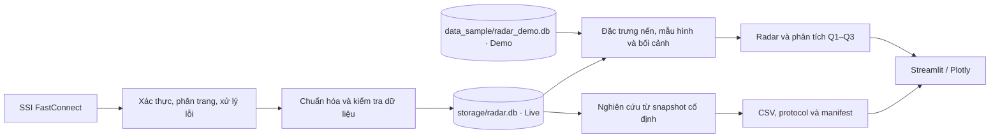

# VN30 Candlestick Radar

**Nhận diện mẫu hình nến · Cảnh báo sớm · Kiểm chứng thống kê**

VN30 Candlestick Radar là ứng dụng Python giúp nhà đầu tư cá nhân và người học phân tích kỹ thuật quét tín hiệu nến trên nhóm cổ phiếu VN30, đọc điều kiện xác nhận và đối chiếu bằng chứng lịch sử.

**SSI FastConnect là nguồn dữ liệu cốt lõi thay NEO API, theo phạm vi đồ án đã được giảng viên chấp thuận.** Sản phẩm sử dụng SQLite để lưu trữ, Streamlit để xây dựng giao diện và Plotly để trực quan hóa.

| Thông tin | Phiên bản nghiên cứu |
|---|---|
| Ngày chốt dữ liệu | **27/11/2026** |
| Phạm vi dữ liệu | 30 mã, 35.759 dòng OHLC, từ 16/11/2021 đến 27/11/2026 |
| Lịch thị trường suy ra | 1.254 phiên |
| Mốc kết thúc tập ước lượng (train) | 20/05/2025 |
| Giai đoạn đánh giá ngoài mẫu (test) | 21/05/2025–27/11/2026 |
| Phiên bản mã đã kiểm chứng | [`6570a33`](https://github.com/Kieuhttk/vn30-candlestick-radar/tree/6570a336f7a950a6e72d8a1e0a5051677ba56536) — 239/239 kiểm thử đạt |

[Video trình diễn](https://drive.google.com/file/d/1EazB0bksOuw-v_PtoCO4hJz-RAp6-J3M/view?usp=sharing) · [Dữ liệu demo offline](data_sample/README.md) · [Hướng dẫn nghiên cứu](docs/RESEARCH_GUIDE.md)

> Công cụ phục vụ học tập và nghiên cứu. Hướng tăng/giảm theo mẫu hình và các mức giá theo dõi là thông tin phân tích, không phải khuyến nghị mua/bán hoặc cam kết lợi nhuận.

## Mục lục

1. [Giới thiệu và ý nghĩa dự án](#gioi-thieu)
2. [Kiến trúc hệ thống](#kien-truc)
3. [Yêu cầu môi trường và cài đặt](#cai-dat)
4. [Hướng dẫn vận hành](#van-hanh)
5. [Cấu trúc thư mục dự án](#cau-truc)
6. [Xử lý sự cố thường gặp](#xu-ly-su-co)
7. [Trạng thái, kết quả và hạn chế đã biết](#trang-thai)

<a id="gioi-thieu"></a>
## 1. Giới thiệu và ý nghĩa dự án

Quét thủ công nhiều biểu đồ dễ bỏ sót tín hiệu và khó duy trì cùng một định nghĩa mẫu hình. Người mới còn dễ nhầm hướng lý thuyết của nến với dự báo chắc chắn, hoặc nhầm tỷ lệ hoàn thành mẫu hình với xác suất đầu tư có lãi.

Ứng dụng kết hợp nhận diện theo quy tắc, giải thích bằng lời và kiểm chứng thống kê để người dùng đọc tín hiệu trong bối cảnh dữ liệu thực tế.

### 1.1. Chức năng chính

- Nạp nến ngày và dữ liệu giao dịch tổng hợp từ SSI, chuẩn hóa và lưu SQLite.
- Nhận diện 19 mẫu hình nến và cảnh báo sớm sau hai nến đầu của Sao mai/Sao hôm.
- Giải thích ý nghĩa, bối cảnh, trạng thái xác nhận và mức vô hiệu tham khảo của từng tín hiệu.
- Hiển thị giá, khối lượng, EMA và vị trí xuất hiện mẫu hình.
- Lọc theo mã, ngày, hướng, trạng thái và khối lượng; lưu danh sách quan tâm, xuất CSV.
- Hiển thị chất lượng dữ liệu, ngày lưu cuối từng mã và nhật ký nạp.
- Đánh giá tần suất, lợi suất sau tín hiệu và khả năng hoàn thành mẫu hình trên lịch sử.
- Chuyển trực tiếp giữa **Demo báo cáo** và **Hằng ngày (Live)**.

### 1.2. Câu hỏi nghiên cứu

| Câu hỏi | Nội dung |
|---|---|
| **Q1 — Tần suất** | Mỗi mẫu hình xuất hiện bao nhiêu lần theo năm và theo mã? |
| **Q2 — Diễn biến sau tín hiệu** | Sau mẫu hình, giá có đi theo hướng lý thuyết tốt hơn mức nền không? |
| **Q3 — Hoàn thành mẫu hình** | Cảnh báo hai nến hoàn thành ở phiên tiếp theo với xác suất bao nhiêu, và dự báo đó có tốt hơn nền không? |

**Mức nền** là kết quả tham chiếu để so sánh với mẫu hình. **Đánh giá ngoài mẫu** sử dụng giai đoạn sau phần lịch sử dùng để ước lượng. Q3 đo hoàn thành mẫu hình ba nến, không đo xác suất có lãi.

<a id="kien-truc"></a>
## 2. Kiến trúc hệ thống



| Thành phần | Trách nhiệm |
|---|---|
| `src/ssi_api/` | Xác thực chỉ đọc, truy vấn dữ liệu, phân trang, giãn yêu cầu và xử lý lỗi API. |
| `src/data/` | SQLite, nạp dữ liệu, kiểm tra chất lượng và đọc snapshot. |
| `src/finance/` | Đặc trưng nến, nhận diện mẫu hình, chỉ báo và bối cảnh. |
| `src/analytics/` | Radar, lợi suất sau tín hiệu, xác suất hoàn thành, bootstrap và hiệu chỉnh nhiều kiểm định. |
| `src/app/` | Giao diện, bộ lọc, giải thích và xuất dữ liệu. |
| `scripts/` | Cập nhật, sao lưu, nghiên cứu và chụp dashboard. |

Hai nhóm API thị trường được sử dụng là `/data/ohlc` và `/data/securitiesSummary`; `/auth/token` phục vụ xác thực. Các endpoint được gọi dưới tiền tố `/api/v3`.

SQLite có bốn bảng chính:

| Bảng | Nội dung |
|---|---|
| `ohlc_daily` | Giá mở cửa, cao nhất, thấp nhất, đóng cửa; khối lượng và giá trị giao dịch. |
| `summary_daily` | Dữ liệu giao dịch tổng hợp để đối chiếu. |
| `quality_issues` | Loại kiểm tra, mức độ và chi tiết theo mã/ngày. |
| `ingest_log` | Thời điểm, phạm vi, số dòng và trạng thái từng lần nạp. |

Khóa `(symbol, trading_date)` chống trùng dữ liệu. Ingest sử dụng giao dịch SQLite và kiểm tra an toàn trước khi thay lịch sử; wrapper cập nhật tạo backup, ghi log và khóa chống chạy đồng thời. Dashboard đọc SQLite; các thao tác lọc và đổi chế độ không gọi API.

<a id="cai-dat"></a>
## 3. Yêu cầu môi trường và cài đặt

### 3.1. Môi trường

- **Python 3.12** cho môi trường đã kiểm chứng.
- Git và trình duyệt để tải mã, mở dashboard.
- Kết nối mạng khi cài thư viện hoặc lấy dữ liệu SSI.
- Khóa SSI có quyền đọc dữ liệu thị trường cho chế độ cập nhật Live.
- Windows cho tác vụ cập nhật bằng Task Scheduler.

Các thư viện chính là NumPy, pandas, SciPy, requests, python-dotenv, Streamlit và Plotly. [pyproject.toml](pyproject.toml) khai báo Python tối thiểu 3.10; [environment_lock.txt](report/environment_lock.txt) ghi các phiên bản thư viện của bộ nghiên cứu, gồm NumPy 2.5.5 và pandas 3.1.1.

### 3.2. Cài đặt trên Windows PowerShell

```powershell
git clone https://github.com/Kieuhttk/vn30-candlestick-radar.git
cd vn30-candlestick-radar
python -m venv .venv
.\.venv\Scripts\python.exe -m pip install -r report/environment_lock.txt
.\.venv\Scripts\python.exe -m pip install -e ".[dev,screenshots]"
```

Các lệnh trong README chạy từ thư mục gốc dự án, nơi có `pyproject.toml`. Trên Linux/macOS, dùng `python3 -m venv .venv` và thay `.\.venv\Scripts\python.exe` bằng `./.venv/bin/python`.

### 3.3. Cấu hình SSI cho Live

```powershell
Copy-Item .env.example .env
```

Các biến cấu hình trong `.env`:

```dotenv
SSI_API_KEY=your_api_key_here
SSI_API_SECRET=your_api_secret_here
RADAR_DB_PATH=storage/radar.db
```

Khóa thật được lưu cục bộ qua biến môi trường hoặc `.env`; `.gitignore` loại tệp bí mật khỏi Git. Ứng dụng chỉ khai thác dữ liệu thị trường, không phát sinh lệnh giao dịch tiền thật. Chế độ Demo không sử dụng khóa SSI.

<a id="van-hanh"></a>
## 4. Hướng dẫn vận hành

### 4.1. Chạy Demo offline

DB mẫu đã có trong kho mã tại `data_sample/radar_demo.db`, với dữ liệu đến **27/11/2026**. Sau khi cài thư viện, mở dashboard bằng:

```powershell
$env:RADAR_DB_PATH = "data_sample/radar_demo.db"
.\.venv\Scripts\python.exe -m streamlit run src/app/main.py
```

Mở **http://localhost:8501** và chọn **Demo báo cáo** ở sidebar. Giá, mẫu hình và kết quả nghiên cứu được đọc từ dữ liệu đi kèm, không cần kết nối SSI. [README của dữ liệu demo](data_sample/README.md) mô tả phạm vi, cấu trúc và metadata.

### 4.2. Chuyển giữa Demo và Live

| Chế độ | File được đọc | Đặc điểm |
|---|---|---|
| **Demo báo cáo** | `data_sample/radar_demo.db` | Dữ liệu cố định đến 27/11/2026, phù hợp trình diễn và đối chiếu báo cáo. |
| **Hằng ngày (Live)** | `storage/radar.db` | DB làm việc, nhận thêm các phiên đã đóng qua SSI. |

Chọn chế độ trong phần **Chế độ dữ liệu**. Đường dẫn tại **Nguồn dữ liệu** được điền cố định và chỉ đọc.

- Khi đổi nguồn, ngày quét về phiên đã đóng mới nhất có trong DB vừa chọn; trang và bộ lọc mã được giữ lại.
- Dashboard kiểm tra thay đổi SQLite mỗi **60 giây**; **Đọc lại SQLite** đọc ngay nguồn đang chọn.
- Khi đang theo dõi phiên mới nhất ở Live, ngày quét theo phiên mới được lưu. Ngày lịch sử do người dùng chọn được giữ lại; **Về phiên gần nhất** đưa giao diện về phiên cuối.
- `RADAR_DB_PATH` chọn nguồn mặc định khi trỏ đúng một trong hai DB trên. Khi không đặt biến này, ứng dụng ưu tiên Live có sẵn rồi đến Demo.

Live hiển thị dữ liệu ngày đã lưu, không phải bảng giá trong phiên. Việc nạp giá do ingest hoặc lịch Windows thực hiện. Nến hôm nay được phân tích sau 15:00 giờ Việt Nam và khi SSI đã trả dữ liệu; thời điểm công bố có thể muộn hơn giờ đóng cửa.

### 4.3. Cách đọc các trang

| Trang | Nội dung |
|---|---|
| **Radar** | Danh sách tín hiệu, ý nghĩa, trạng thái, bối cảnh và điều kiện theo dõi. |
| **Biểu đồ** | Nến giá, khối lượng và vị trí mẫu hình theo mã. |
| **Kết quả nghiên cứu** | Tần suất, lợi suất sau tín hiệu, kết quả ngoài mẫu và xác suất hoàn thành. |
| **Chất lượng** | Ngày dữ liệu cuối, cảnh báo dữ liệu và nhật ký nạp. |
| **Phương pháp** | Định nghĩa, giả định và giới hạn phân tích. |

Với người mới, trình tự đọc là **ý nghĩa → trạng thái → bối cảnh → điều kiện theo dõi → bằng chứng lịch sử**. Các mức xác nhận và vô hiệu hỗ trợ quan sát, chưa xác lập một chiến lược giao dịch có lãi.

### 4.4. Nạp và cập nhật Live

Sau khi cấu hình SSI, kiểm tra kết nối và nạp lịch sử:

```powershell
.\.venv\Scripts\python.exe -m ssi_api.probe FPT
.\.venv\Scripts\python.exe -m data.ingest --db storage/radar.db --since 2021-11-16
```

Danh sách 30 mã nằm tại `src/data/universe_vn30.txt`. Tham số `--symbols FPT,VCB` chọn một nhóm mã cho lần nạp.

DB làm việc được cập nhật bằng wrapper có backup:

```powershell
.\.venv\Scripts\python.exe scripts/data/update_data.py --db storage/radar.db
.\.venv\Scripts\python.exe scripts/data/update_data.py --db storage/radar.db --status
```

Backup được lưu trong `storage/backups/`; trạng thái và log cập nhật nằm trong `report/update_logs/`. Bảng ngày cuối từng mã phản ánh dữ liệu thực tế đã lưu. Exit code thành công của tiến trình không tự xác nhận SSI đã có phiên mới.

Đăng ký lịch Windows lúc 18:00 và thử lại lúc 19:00:

```powershell
.\.venv\Scripts\python.exe scripts/system/install_update_task.py --at 18:00 --retry-at 19:00 --db storage/radar.db
.\.venv\Scripts\python.exe scripts/system/install_update_task.py --status --db storage/radar.db
```

Lịch sử dụng giờ Windows, mạng và phiên đăng nhập của người dùng. Máy đang bật, không ngủ và đặt múi giờ Việt Nam là điều kiện vận hành. Tác vụ cập nhật `storage/radar.db`; dữ liệu demo và snapshot nghiên cứu được giữ cố định.

### 4.5. Kiểm tra chất lượng

```powershell
.\.venv\Scripts\python.exe -m data.ingest --db storage/radar.db --status
.\.venv\Scripts\python.exe -m data.ingest --db storage/radar.db --audit
.\.venv\Scripts\python.exe -m data.ingest --db storage/radar.db --log
.\.venv\Scripts\python.exe -m data.ingest --db storage/radar.db --issues --symbols FPT
.\.venv\Scripts\python.exe scripts/data/check_data.py
```

`check_data.py` đọc `storage/radar.db` và xuất `report/data_quality.csv`. SQLite `quick_check: OK` xác nhận tính toàn vẹn tệp; các cảnh báo giá, thiếu phiên và vượt biên độ vẫn được đối chiếu với phạm vi dữ liệu, lịch nghỉ, sàn và thời kỳ giao dịch.

Bộ demo có **437 warning lưu trong DB**; dashboard suy thêm **14 mục thiếu phiên**, tổng cộng **451 mục cần đối chiếu**. Bảng `ingest_log` của demo được làm rỗng khi đóng gói, nên trang Chất lượng hiển thị lời giải thích thay cho nhật ký vận hành.

### 4.6. Tái lập nghiên cứu

Bộ nghiên cứu đã hoàn tất nằm tại `report/tables_final/`, `report/oos_verified/` và `report/supplement_20261127/`. Dữ liệu demo khớp dấu vân tay đầu vào của bộ ngoài mẫu; các kết quả này mở trực tiếp trên dashboard.

Các lệnh dưới đây tái tính từ demo vào thư mục riêng cho từng lần chạy:

```powershell
$studyRun = Get-Date -Format "yyyyMMdd_HHmmss"
.\.venv\Scripts\python.exe scripts/run_study.py --db data_sample/radar_demo.db --asof 2026-11-27 --sensitivity --resamples 39999 --out "report/reproduction_$studyRun/in_sample"
.\.venv\Scripts\python.exe scripts/run_study.py --db data_sample/radar_demo.db --asof 2026-11-27 --oos --train-end 2025-05-20 --sensitivity --resamples 39999 --out "report/reproduction_$studyRun/oos"
```

Q2 sử dụng kỳ hạn **1/3/5/10/20 phiên**, phí **20/40 bps** và nhóm **280 phép kiểm định định trước**. Nền được ước lượng từ train, với kiểm tra purge, lịch sử khởi tạo và bootstrap theo khối ngày. `protocol` lưu thiết kế; `manifest` lưu nguồn, cấu hình và mã băm. Thư mục tái tính độc lập với bộ đã chốt.

[Hướng dẫn nghiên cứu](docs/RESEARCH_GUIDE.md) mô tả chi tiết snapshot, Q1–Q3, mô phỏng và các kiểm tra bổ sung. Tái tính ngoài mẫu với 39.999 lượt lấy mẫu có thời gian chạy dài hơn kiểm thử đơn vị.

### 4.7. Kiểm thử và chụp giao diện

```powershell
.\.venv\Scripts\python.exe -m pytest -q
```

Phiên bản tham chiếu [`6570a33`](https://github.com/Kieuhttk/vn30-candlestick-radar/tree/6570a336f7a950a6e72d8a1e0a5051677ba56536) có **239 kiểm thử đạt**, gồm **14 kiểm thử giao diện**, không có failed/error/skip.

| Lần kiểm chứng | Kết quả | Thời gian pytest | Bằng chứng |
|---|---|---|---|
| Windows 11, Python 3.12.8 | 239 passed | 77,12 giây | `report/verification/pytest_final.log`, `pytest_final.xml`, `test_manifest.json` trong repo |
| Linux, Python 3.12 | 239 passed | 28,56 giây | `kiem_chung/pytest_final.xml` và `audit_final.json` trong gói báo cáo |

Hai thời gian thuộc hai môi trường chạy khác nhau. Cả hai lần dùng NumPy 2.5.5 và pandas 3.1.1.

Ảnh giao diện chốt được lưu tại `report/screenshots_final_20261127/`. Để chụp thêm, giữ dashboard đang mở ở Demo và chạy trong terminal thứ hai:

```powershell
.\.venv\Scripts\python.exe -m playwright install chromium
$screenRun = Get-Date -Format "yyyyMMdd_HHmmss"
.\.venv\Scripts\python.exe scripts/app/capture_dashboard.py --url http://localhost:8501 --expect-asof 2026-11-27 --cutoff-date 2026-11-27 --out "report/screenshots_$screenRun"
```

Mỗi lần chụp có thư mục riêng; `capture_manifest.json` ghi thời điểm chụp, trang và ngày phân tích hiển thị.

<a id="cau-truc"></a>
## 5. Cấu trúc thư mục dự án

```text
vn30-candlestick-radar/
├── .streamlit/                  # Cấu hình giao diện
├── assets/fonts/                # Font và giấy phép
├── src/
│   ├── ssi_api/                 # Client và probe SSI
│   ├── data/                    # SQLite, ingest, chất lượng, snapshot
│   │   └── universe_vn30.txt    # Rổ mã nghiên cứu
│   ├── finance/                 # Nến, mẫu hình, chỉ báo và bối cảnh
│   ├── analytics/               # Radar, Q1–Q3 và suy luận thống kê
│   └── app/                     # Dashboard Streamlit
├── scripts/
│   ├── data/                    # Cập nhật và kiểm tra dữ liệu
│   ├── system/                  # Lịch Windows
│   ├── app/                     # Chụp dashboard
│   ├── analytics/               # Lệnh thống kê cảnh báo
│   ├── research/                # Hiệu chuẩn và độ vững
│   ├── maintenance/             # Công cụ bảo trì
│   ├── backup_sqlite.py         # Sao lưu SQLite
│   └── run_study.py             # Chạy nghiên cứu Q1–Q3
├── tests/                       # Kiểm thử tự động
├── docs/                        # API, định nghĩa và hướng dẫn
├── data_sample/
│   ├── radar_demo.db            # Dữ liệu demo đến 27/11/2026
│   ├── metadata.json            # Nguồn, ngày và SHA-256
│   └── README.md
├── storage/                     # DB Live, snapshot, backup cục bộ
├── report/
│   ├── tables_final/            # Kết quả toàn mẫu
│   ├── oos_verified/            # Kết quả ngoài mẫu và protocol
│   ├── supplement_20261127/     # Các kiểm tra bổ sung
│   ├── presentation/            # Bảng trình bày và số liệu báo cáo
│   ├── screenshots_final_20261127/
│   ├── calibration_oos/         # Mô phỏng và snapshot mã nguồn
│   └── verification/            # Bằng chứng kiểm thử Windows
├── archive/                     # Lịch sử; installers/ còn được test sử dụng
├── .env.example
├── .gitignore
├── pyproject.toml
└── README.md
```

`storage/`, môi trường `.venv/` và log cập nhật là dữ liệu vận hành cục bộ. Thư mục `kiem_chung/` thuộc gói báo cáo nộp kèm, chứa biên bản rà soát và kiểm chứng Linux.

<a id="xu-ly-su-co"></a>
## 6. Xử lý sự cố thường gặp

| Hiện tượng | Cách xử lý |
|---|---|
| Không tìm thấy module `data` hoặc `analytics` | Chạy tại gốc dự án, dùng Python trong `.venv` và cài editable bằng `pip install -e ".[dev,screenshots]"`. |
| Dashboard hiển thị ngày cũ | Demo giữ ngày 27/11. Với Live, cập nhật `storage/radar.db`, bấm Đọc lại SQLite và Về phiên gần nhất. |
| Live báo thiếu DB | Nạp lần đầu bằng `python -m data.ingest --db storage/radar.db --since 2021-11-16`, hoặc chọn Demo. |
| Nhật ký trong Demo trống | Đây là đặc điểm của bản đóng gói: bảng nhật ký có cấu trúc nhưng không chứa log vận hành. |
| Chưa có nến hôm nay | Đối chiếu giờ Việt Nam, lịch nghỉ và thời điểm SSI công bố dữ liệu; ứng dụng dùng nến ngày đã đóng. |
| SSI báo thiếu khóa hoặc xác thực thất bại | Kiểm tra biến `SSI_API_KEY`, `SSI_API_SECRET`, quyền đọc dữ liệu và kết quả `ssi_api.probe`. |
| Lịch chạy xong nhưng DB chưa có phiên mới | Xem ngày cuối từng mã và log trong `report/update_logs/`; lịch chạy thành công không đồng nghĩa nhà cung cấp đã có dữ liệu. |
| Không hiển thị kết quả ngoài mẫu | Trang nghiên cứu kiểm tra ngày quét, protocol, mã băm CSV và dấu vân tay đầu vào. Chọn Demo để xem bộ cố định 27/11. |
| `database is locked` hoặc đang có lần cập nhật khác | Chờ tiến trình nạp hiện tại kết thúc; wrapper chỉ cho một lần cập nhật trên cùng DB. |
| Thư mục đầu ra đã có dữ liệu | Chọn tên lần chạy khác bằng `$studyRun` hoặc `$screenRun`; các kết quả được bảo vệ khỏi ghi đè. |
| `--db: expected one argument` | Truyền đường dẫn trực tiếp hoặc khai báo lại biến PowerShell đang rỗng. |
| `KeyError: S? phi?n` khi dán Python qua pipe | Dùng tệp UTF-8 hoặc thiết lập mã hóa UTF-8 cho terminal; các script dự án đã xử lý đầu ra UTF-8. |
| `WinError 5` khi lưu danh sách quan tâm | Kiểm tra quyền ghi vào `storage/preferences/` và tiến trình đang giữ tệp. |

<a id="trang-thai"></a>
## 7. Trạng thái, kết quả và hạn chế đã biết

### 7.1. Trạng thái triển khai

| Hạng mục | Trạng thái |
|---|---|
| SSI, SQLite, kiểm tra chất lượng, backup và nhật ký | Đã triển khai. |
| Dashboard năm trang, thẻ giải thích, lọc và xuất dữ liệu | Đã triển khai. |
| Hai chế độ Demo/Live | Đã triển khai và kiểm thử chuyển nguồn, giữ bộ lọc, cập nhật ngày. |
| Q1–Q3 và đánh giá ngoài mẫu hồi cứu | Đã hoàn tất với bộ dữ liệu chốt 27/11/2026. |
| Độ nhạy, MDE, đối chứng Q3, loại mã và đối chiếu lịch | Đã thực hiện trên cùng bộ chính 27/11. |
| Kiểm thử | 239/239 test đạt tại phiên bản tham chiếu `6570a33`. |
| Q4 — học máy | Ngoài phạm vi phiên bản hiện tại. |

### 7.2. Kết quả nghiên cứu chốt 27/11/2026

| Nội dung | Kết quả |
|---|---|
| Q1 — nhãn mẫu hình | 15.288 nhãn; một phiên có thể có nhiều nhãn. |
| Q3 — toàn bộ lịch sử | Sao mai 9/112 = 8,04%; Sao hôm 30/260 = 11,54%. |
| Q2 — ngoài mẫu | 280 phép định trước, 108 kết quả kiểm định hợp lệ; q nhỏ nhất = 1,00; không có q < 0,05. |
| Q3 — ngoài mẫu | Sao mai 4/37 = 10,81%; Sao hôm 10/90 = 11,11%. |
| Điểm Brier ngoài mẫu gộp | Mô hình 0,098433; nền 0,098109; skill −0,33%. |
| Kết luận chính | Chưa đủ bằng chứng mô hình chính dự báo tốt hơn nền theo thiết kế đã chọn. |

Kết quả Q2 dùng lợi suất sau phí đã đổi dấu theo hướng lý thuyết và so với mức nền train. Bảng 14 mẫu hình × 1/3/5 phiên trình bày hiệu ứng theo **điểm phần trăm**, tách khỏi lợi nhuận long giả định. Kỳ hạn 10/20 phiên chưa đủ số khối test cho suy luận theo protocol.

Các kiểm tra bổ sung lượng hóa MDE, so sánh Q3 với nhóm chỉ có điều kiện nến 1, chạy lại khi loại BSR/MCH/VPL và đối chiếu lịch nghỉ. MDE80 là hiệu ứng tối thiểu có thể phát hiện với power 80% theo xấp xỉ; **BY hạng 1** là ngưỡng áp dụng cho p nhỏ nhất trong nhóm kiểm định.

| Bằng chứng | Vị trí |
|---|---|
| Toàn mẫu Q1–Q3 | `report/tables_final/` |
| Q2, Q3 ngoài mẫu | `report/oos_verified/q2_oos_summary.csv`, `q3_oos_summary.csv` |
| Thiết kế và nguồn | `report/oos_verified/oos_protocol.json`, `manifest.json` |
| Bảng Q2 14 × 3 | `report/presentation/q2_14_patterns_1_3_5.csv` |
| Số liệu tổng hợp báo cáo | `report/presentation/report_numbers_20261127.json` |
| Các kiểm tra độ vững | `report/supplement_20261127/` |
| Dữ liệu mẫu và metadata | `data_sample/radar_demo.db`, `metadata.json` |
| Ảnh giao diện | `report/screenshots_final_20261127/` |
| Mô phỏng độc lập | `report/calibration_oos/` |
| Kiểm thử Windows | `report/verification/` |

DB demo khớp dấu vân tay train và toàn snapshot của bộ ngoài mẫu. Các bảng chính và bổ sung có mã băm khớp manifest; các phân tích bổ sung liên kết với cùng manifest chính 27/11. Mô phỏng random walk là dữ liệu giả lập độc lập với dữ liệu SSI, có thiết kế và snapshot mã nguồn riêng.

### 7.3. Hạn chế còn lại

- **Rổ cố định:** chưa tái dựng thành phần VN30 và sàn giao dịch theo từng thời điểm.
- **Ngoài mẫu hồi cứu:** lịch sử từng được khám phá; kết quả chưa tương đương kiểm chứng tiến cứu.
- **Giá điều chỉnh:** lịch sử có thể thay đổi theo thời điểm lấy dữ liệu; lọc ngày không khôi phục được vintage cũ.
- **Lịch và chất lượng:** đối chiếu lịch công bố chưa bao quát mọi đợt ngừng giao dịch riêng lẻ.
- **Suy luận thống kê:** mẫu hình hiếm, phụ thuộc giữa ngày/mã và giả định bootstrap ảnh hưởng độ tin cậy. Một kết quả Q3 phụ sau loại mã có p/q nhỏ nhưng CI chứa 0; chưa được xem là ưu thế dự báo vững.
- **Khả năng giao dịch:** phí và trượt giá là kịch bản; OHLC ngày chưa mô phỏng đầy đủ thanh khoản, hàng chờ và thanh toán.
- **Quy tắc theo dõi:** ngưỡng khối lượng, xác nhận và vô hiệu hỗ trợ diễn giải, chưa phải chiến lược sinh lời đã xác nhận.
- **Vận hành:** cập nhật Live phụ thuộc máy Windows, tác vụ, mạng và dữ liệu SSI.

### 7.4. Tài liệu liên quan

- [Dữ liệu demo offline](data_sample/README.md).
- [Quy trình nghiên cứu và tái lập](docs/RESEARCH_GUIDE.md).
- [Định nghĩa mẫu hình](docs/pattern_definitions.md).
- [Ghi chú kiểm chứng API](docs/api_notes.md).
- [Quyết định xử lý chất lượng](docs/data_quality_decisions.md).
- [Lịch cập nhật dữ liệu](docs/AUTO_UPDATE_REPAIR.md).
- [Các tính năng dashboard](docs/UPGRADE_FEATURES.md).
